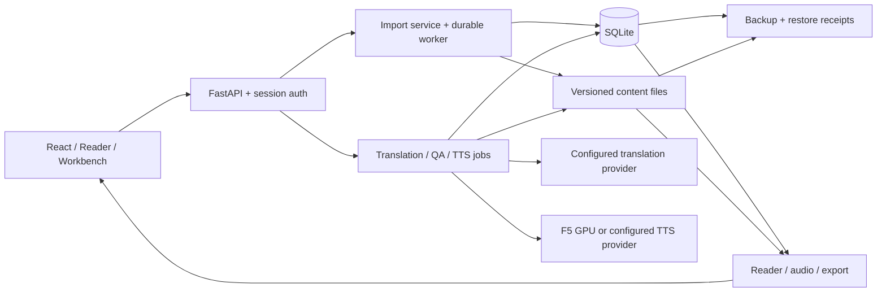

# Đánh giá tổng hợp Novel-TNN — 15/10/2026

Novel-TNN đã có bộ chức năng khá đầy đủ cho một người vận hành: nhập truyện, dịch và QA, quản lý thuật ngữ, Reader/PWA, TTS, xuất sách/audio và backup/restore. Ưu tiên tiếp theo là sửa những điểm làm gián đoạn luồng sử dụng và chứng minh chất lượng thực tế của dịch/giọng đọc. Phạm vi đánh giá là ứng dụng cá nhân/private deployment, không giả định sản phẩm nhiều tenant.

**Mốc đánh giá:** `dfe9e1d8ccf259034c3401e72b3250396635f9b7`, branch `upgrade-b/00-baseline-and-agent-guidance`. Commit đóng gói 156 file triển khai/test/tài liệu đã có trong worktree; phiên audit này không sửa hành vi sản phẩm. Nguồn gốc trước commit: `a41cd84dae42b745f196fac90a51356cf896a007` cộng các thay đổi được băm trong manifest. Các phát hiện dưới đây vẫn còn mở tại mốc này.

Bản sao kiểm tra `/tmp/novel-tnn-audit-20261015-prpvmnm5` chứa 829 file có SHA-256, sử dụng Python 3.11.15, Node 22.23.0, npm 10.9.8 và dependency đã cài. DB, cấu hình và log thử tách khỏi dữ liệu operator. Import Python được xác nhận từ candidate. Kết quả kiểm tra dưới đây được chạy mới trong phiên audit, trước commit, rồi đối chiếu byte với nội dung commit; không gọi chúng là một lần chạy sau commit.

| Phần | Đánh giá hiện tại | Phần cần hoàn thiện |
|---|---|---|
| Kiến trúc | React/Vite → FastAPI → service/domain → SQLite và file; đã tách các repository và controller Reader/import | Tiếp tục tách theo trách nhiệm khi có nhu cầu sửa cụ thể; không cần đổi nền tảng |
| Import | Có nhập text/ebook/URL, preview/confirm, chống trùng, transaction và job bền vững | Nhánh timeout không proxy; kiểm soát địa chỉ kết nối thực tế |
| Dữ liệu | Có revision/hash, kiểm tra xung đột, ghi file phiên bản mới rồi cập nhật DB, bảo vệ artifact đang được dùng | Cần diễn tập recovery trên bản release sắp triển khai; chưa kiểm tra DB operator ở phiên này |
| Dịch/QA | Cache gắn prompt/provider/style; QA phân biệt partial/stale/legacy và kiểm tra bản dịch cuối | Chưa có đánh giá mới bằng corpus, provider thật và người đọc |
| TTS/export | GPU-only F5 guard, process deadline/cancel, QA audio và cache có hash; test FFmpeg/M4B thật | Chưa chứng minh phát âm, thiếu câu, nhịp nghỉ và tốc độ inference thật |
| Reader/PWA | Có progressive rendering, abort request, offline, bookmarks/annotations, audio và touch tests | Regex thiếu giới hạn; cần thử thiết bị thật, screen reader và phiên đọc/nghe dài |
| Job/API | Có lease, heartbeat, retry/cancel và trạng thái interrupted | Một số route async còn chạy công việc đồng bộ, chặn API |
| Vận hành/release | Có readiness, runtime identity, receipt recovery và alert rules | Runbook lệch release đang chạy; chưa xác minh delivery cảnh báo và recovery hiện tại |

Ba luồng được truy vết: `create_import_job` → `ImportJobService`/worker → source adapter → import commit; `JobService` → `PipelineService` → dịch/QA → publication có revision/hash; Reader → API content/search/audio → artifact resolver/SQLite. CLI và dashboard cũ còn là caller của dịch/publication, được bao phủ trong các regression legacy. Các ranh giới đáng giữ lại là domain repository, publication theo revision, QA gắn đúng nội dung và cancellation trước công bố audio.

**Những việc cần sửa trước khi coi bản tiếp theo là sẵn sàng vận hành**

1. **P1 — Runbook release/rollback không khớp container hiện tại.**

   [Runbook](../production-release-runbook.md) dòng 14–15 chọn release `upgrade-b-production-20260725-r1` và rollback tương ứng. `docker inspect` chỉ đọc trong phiên này xác nhận cả API và import-worker đang dùng tag `glossary-upgrade-20260830-r1`, Docker báo healthy. Test [release contract](../../tests/test_production_release_contract.py) cũng hard-code release tháng 7, nên có thể PASS dù quy trình vận hành đã lệch thực tế.

   Nếu làm theo runbook, operator có thể chọn một bản cũ ngoài ý định. Cần lập một record release được đối chiếu với image ID/digest, API/worker identity và rollback đã duyệt; dùng record đó trong runbook và test. Chưa xác minh source bên trong image, chưa render cấu hình chứa secret, chưa deploy hoặc chạy rollback. Đây là mismatch đã quan sát, không phải kết luận hai container đang lỗi.

2. **P1 — Test provider và metrics có thể chặn các request khác.**

   [providers.py:81](../../app/mobile_api/routers/providers.py) gọi service đồng bộ trong `async def`; [provider_service.py:161](../../app/mobile_api/services/provider_service.py) dùng `requests.post` với timeout cấu hình, fallback 180 giây. [operations.py:26](../../app/mobile_api/routers/operations.py) cũng gọi `snapshot()` đồng bộ, trong đó có SQLite và quét đường dẫn artifact.

   Hai route thật được gắn vào ASGI app thử với service đồng bộ giả lập 250 ms. Callback được đưa vào event loop ngay khi service bắt đầu đều bị trễ 251 ms. Đây là bằng chứng chặn vòng xử lý, không phải benchmark tải production. Sửa nhỏ nhất là chuyển route phù hợp thành `def` hoặc offload service, giữ exception/auth/audit và thêm hai ca vào [test responsiveness](../../tests/test_mobile_api_responsiveness.py). Nếu bỏ qua, thao tác kiểm tra provider hoặc metrics có thể làm Reader/health tưởng ứng dụng bị treo.

3. **P2 — Timeout import khi không có proxy bị biến thành lỗi nội bộ.**

   [source_adapters.py:1102](../../app/ingestion/source_adapters.py) chỉ khởi tạo `proxy` bên trong nhánh pool có phần tử; handler ở dòng 1134 và 1153 vẫn đọc biến đó. Mock `ConnectTimeout` với pool rỗng tái hiện `UnboundLocalError`, thay vì `SourceAdapterError` có mã `connect_timeout` và cờ retry. Nhánh `ProxyError` cũng cho cùng lỗi trong fixture.

   Khởi tạo `proxy = None` trước nhánh và thêm regression pool rỗng là đủ. Phạm vi caller gồm fetch, preview và generic chapter adapter; không cần thay cơ chế browser/session. Nếu bỏ qua, lỗi mạng bình thường có thể bị báo sai và không đi đúng luồng retry.

4. **P2 — Regex của Reader chưa có giới hạn thời gian, ở cả frontend và backend.**

   [readerSearch.ts:31](../../web/src/state/readerSearch.ts) tạo `RegExp`, rồi chạy trực tiếp trong đường render qua [useReaderSearch](../../web/src/components/reader/useReaderSearch.ts). Backend [pipeline_service.py:757](../../app/mobile_api/services/pipeline_service.py) tạo `re.Pattern` rồi `.search()` trên các đoạn toàn sách. AbortController phía client không ngắt một regex đồng bộ đã bắt đầu.

   Helper thật của cả hai phía được chạy với dữ liệu tổng hợp 31 ký tự và một regex lặp lồng nhau. Cả Python và Node đều phải bị kết thúc sau ngưỡng một giây; literal search kết thúc trong vài ms. Chưa chạy truy vấn này trên trình duyệt hay production. Cần đặt ngân sách công việc và cơ chế có thể ngắt execution cho regex; nếu vẫn giữ regex tùy ý thì worker/process isolation phải thực sự enforce deadline. Chỉ giới hạn độ dài query hoặc debounce không giải quyết ca này. Giữ tìm kiếm literal/Unicode hiện có và thêm regression quá ngân sách.

**Những việc nên hoàn thiện tiếp theo**

5. **P2 — Dependency cần một đợt cập nhật có giới hạn và bộ cài Python tái lập được.**

   `npm --prefix web audit --json` exit 1, báo 5 package entries: 3 high, 2 moderate. Phiên bản cài: `nanoid 3.3.14`, `source-map-js 1.2.1`, `undici 7.28.0`, `vitest/@vitest/mocker 4.1.9`. Đường phụ thuộc đi qua Vite/PostCSS, jsdom và Vitest. Docker runtime phục vụ `web/dist`; không thể suy ra 5 lỗ hổng public trong ứng dụng từ con số này.

   Advisory [Vitest](https://github.com/vitest-dev/vitest/security/advisories/GHSA-82fw-gwwq-j7x9) nêu điều kiện dev server/plugin; advisory [Undici](https://github.com/nodejs/undici/security/advisories/GHSA-w293-vg96-wgc3) phụ thuộc cách dùng BalancedPool/custom TLS. Bản vá source-map-js được công bố tại [v1.2.2](https://github.com/7rulnik/source-map-js/releases/tag/v1.2.2). Cần cập nhật dependency/lock bằng package manager trong một patch riêng, kiểm tra khả năng tiếp cận từng lỗi và chạy checks liên quan; không chạy `audit fix --force` hàng loạt.

   [requirements.txt](../../requirements.txt) và [pyproject.toml](../../pyproject.toml) vẫn dùng khoảng phiên bản, không có bộ lock deployment đầy đủ. `pip check` PASS chỉ xác nhận tương thích dependency đã cài. `pip-audit` không có trong `.venv`, chưa audit advisory Python lần này và không tự cài thêm công cụ. Các advisory Python trong báo cáo cũ không được tái sử dụng làm kết luận hiện tại.

6. **P2, bằng chứng mã nguồn — DNS preflight chưa ràng buộc peer của kết nối.**

   [url_policy.py:66](../../app/security/url_policy.py) kiểm tra IP phân giải; [source_adapters.py:1125](../../app/ingestion/source_adapters.py) sau đó gửi hostname cho Requests. IP đã kiểm tra không được gắn vào transport. [stealth_browser.py:267](../../app/utils/stealth_browser.py) có guard cho request nhưng Chromium vẫn tự thiết lập kết nối.

   Nếu DNS thay đổi giữa kiểm tra và kết nối, hoặc đường proxy phân giải khác, preflight không đủ bảo đảm peer vẫn là IP được phép. Direct import có allowlist, làm giảm phạm vi; chưa có exploit vào mạng nội bộ được thử hay chứng minh. Cần xử lý transport/egress có kiểm tra peer và redirect/TLS phù hợp, giữ browser lifecycle, kiểm tra bằng fixture local. Không suy rộng bảo vệ Requests sang Chromium.

7. **Khoảng trống chất lượng — Dịch và audio cần nghiệm thu bằng đầu ra thật.**

   [qa_report.py](../../app/translation/qa_report.py) đã phân biệt kết quả không đủ bằng chứng, và [audio_qa.py](../../app/services/tts/audio_qa.py) kiểm tra âm lượng, clipping, im lặng, thời lượng. Những kiểm tra đó chưa đo độ trung thành bản dịch, đại từ, phát âm tên riêng, thiếu câu hay sự dễ nghe. `.venv` kiểm tra hiện không có `torch`, `f5_tts`, `vinorm`; chưa kiểm tra runtime tương ứng bên trong container.

   Bổ sung một corpus nhỏ cố định, có quyền sử dụng, gồm chương ngắn/dài, hội thoại, tên riêng và số liệu; ghi model/provider/prompt/glossary/reference hash, chi phí và thời gian. Người đọc/nghe đánh giá trực tiếp, ghi lỗi cụ thể và ngưỡng chấp nhận trước khi thử. Dùng smoke thật có sẵn khi có cấu hình/quyền gọi provider. Đây là khoảng trống quan trọng để hoàn thiện sản phẩm, không phải kết luận chất lượng hiện tại kém.

8. **Khoảng trống kiểm thử — E2E hiện tại chưa nối browser với backend thật; gate tự động chưa chạy project mobile.**

   [web/e2e/novel-tnn.spec.ts:228](../../web/e2e/novel-tnn.spec.ts) intercept API bằng mock. [playwright.config.ts](../../web/playwright.config.ts) khởi động Vite preview. [verify.sh:92](../../scripts/verify.sh) và [CI](../../.github/workflows/ci.yml) chỉ chọn `chromium`; hai test `@mobile-device` được chạy riêng trong audit này nhưng chưa là gate thường lệ.

   Bổ sung một smoke nhỏ browser → FastAPI → SQLite/file thật với provider giả lập: đăng nhập → import → job → đọc → export → khởi động lại → đọc lại. Giữ test UI nhanh hiện có, đồng thời đưa project mobile vào gate khi thay đổi CI được phê duyệt. Thử thêm Android thật cho đọc/nghe lâu, offline và chuyển app; kiểm tra keyboard/screen reader. Không gọi Pixel emulation là chứng nhận thiết bị thật.

9. **Khoảng trống vận hành — Cần chứng minh cảnh báo đến người vận hành và recovery của release mới.**

   [operational_metrics_service.py](../../app/mobile_api/services/operational_metrics_service.py) đã tạo alert cho worker, disk, queue, artifact và recovery receipt; [runbook vận hành](../operations/runtime-alerts-and-rollback.md) yêu cầu polling. Tìm trong `app/`, `scripts/`, tests và CI không thấy notifier tương ứng; một hệ thống monitor bên ngoài vẫn có thể tồn tại và chưa được kiểm tra.

   Cần nối một kênh cảnh báo với test delivery có receipt, rồi diễn tập restore cô lập từ backup phù hợp và đọc được text/audio trên release mục tiêu. Chọn RPO/RTO dựa vào nhu cầu của operator. Phiên này chỉ đọc metadata hai container; không chứng nhận freshness backup, khả năng rollback hay thời gian phục hồi thực tế.

**Thứ tự hoàn thiện đề xuất**

| Thứ tự | Kết quả cần đạt | Tiêu chí hoàn tất |
|---|---|---|
| 1 | Sửa route chặn API, timeout không proxy và regex | Tái hiện cũ thất bại đúng nguyên nhân; regression mới PASS; health vẫn phản hồi và regex bị ngắt đúng hạn |
| 2 | Đối chiếu release/rollback và dependency | Nguồn/build/image có identity rõ; runbook không chọn nhầm bản; advisory được sửa hoặc có kết luận reachability cụ thể |
| 3 | Chứng minh toàn luồng ứng dụng và mobile | Smoke backend thật + mobile gate; thử thiết bị thật và accessibility có kết quả quan sát |
| 4 | Nghiệm thu chất lượng dịch/TTS | Corpus/model/reference được định danh; kết quả người đọc/nghe, thời gian và chi phí đạt tiêu chí đã đặt |
| 5 | Hoàn thiện vận hành dài ngày | Cảnh báo được nhận; restore/rollback trên môi trường riêng có receipt và thời gian đo được |

Chưa có bằng chứng cần thay SQLite, thêm microservice, viết lại frontend hoặc tăng số tính năng AI. Các module vẫn lớn (PipelineService 3.727 dòng, db.py 3.469, ReaderView 2.669, source_adapters 2.841), nhưng số dòng không tự chứng minh một lỗi. Tách tiếp khi một sửa đổi cụ thể cần ranh giới rõ hơn, giữ compatibility và các invariant đang được kiểm tra.

**Bằng chứng kiểm tra trong phiên này**

| Lệnh/kiểm tra | Kết quả | Giới hạn |
|---|---|---|
| `NOVEL_PIPELINE_IGNORE_DOTENV=1 DATA_DIR=<candidate>/data scripts/verify.sh --with-e2e` | Exit 0; đủ 10 gate. Backend 1.390 PASS, 389,49 s; frontend 794 PASS/88 file; desktop E2E 14 PASS, 24,6 s | Hai test mobile skip có chủ đích ở desktop; môi trường fixture, không production |
| `npm --prefix web run test:e2e -- --project=mobile-chromium` | Exit 0; 2 PASS, 15,5 s | Pixel 7 emulation, API mock |
| Compile, shell syntax, environment, `scripts/lint.sh`, `pip check`, frontend build | PASS trong aggregate trên | Không chạy lặp lại các leaf gate cùng đầu vào |
| Probe import timeout, Python/JS regex và hai route API | Tái hiện các lỗi ở mục 2–4; probe process exit 0 nghĩa là đã ghi được bằng chứng | Regex child bị kill có chủ đích ở deadline 1 s; lỗi sản phẩm chưa sửa |
| `npm --prefix web audit --json` | Exit 1; 5 entries (3 high, 2 moderate) | Advisory scan, chưa chứng minh exploit production |
| `git diff --check` trước staging | Exit 0 | Chưa bao gồm các file untracked ở thời điểm đó |
| `git diff --cached --check` sau staging | Exit 2; 13 cảnh báo dòng trống cuối file có sẵn | Giữ nguyên bytes của phần triển khai đã kiểm thử; không nới rule hay che cảnh báo |
| `docker inspect` hai container, chỉ image identity/health | Exit 0; cả hai healthy, release tag tháng 8 | Không thay cho ứng dụng smoke, source binding hoặc recovery test |

Cảnh báo khác: passlib sử dụng `crypt` sắp bị loại ở Python 3.13; project đang yêu cầu Python 3.11. Playwright in cảnh báo `NO_COLOR`/`FORCE_COLOR`. Không thay dependency/cấu hình để che các cảnh báo.

Artifacts local tại `work/repo-research/novel-tnn/audit-2026-10-15/`: `source-manifest.json`, `commit-scope.json`, `verify.log`, `mobile-e2e.log`, `probes.py`/`probes.json`, `loop-probe.py`/`loop-probe.json`, `frontend-regex-probe.json`, `npm-audit.json`, `npm-tree.json`, `python-packages.json`, `runtime-images.txt`, `staged-diff-check.log`, `final-reconciliation.json`. Các log/fixture không đưa vào Git. Probe provider ở `probes.json` lên lịch ping trước khi dependency hoàn tất nên không dùng để kết luận route không chặn; `loop-probe.json` đo từ lúc service bắt đầu và là bằng chứng dùng trong báo cáo.

Artifact ledger: REPO_MAP, ARCHITECTURE_MAP và ENTRYPOINT_TRACE dựa trên graph rồi đối chiếu source trực tiếp; BUILD_RUN_MATRIX là bảng lệnh trên; RISK_REGISTER là 9 mục có trạng thái bằng chứng; REUSABLE_IDEAS gồm publication/version identity, cache theo cấu hình hiệu lực, bounded job lifecycle và offline/request ownership. Index có một số TSX parse-partial; không dùng graph để khẳng định đã bao phủ mọi nhánh. Nguồn quan trọng và các quan hệ được đọc trực tiếp.

Không đọc toàn bộ mọi file; chưa audit advisory Python, build Docker mới, thử provider/GPU thật, thử thiết bị Android thật, kiểm tra DB/backup production hay chạy rollback. Chưa push/deploy. Thư mục `.memento/`, file ZIP và ba bộ audit thô cũ được giữ ngoài commit. Rủi ro chính còn lại là các lỗi đã tái hiện, release documentation drift và chất lượng thực tế chưa được nghiệm thu.
