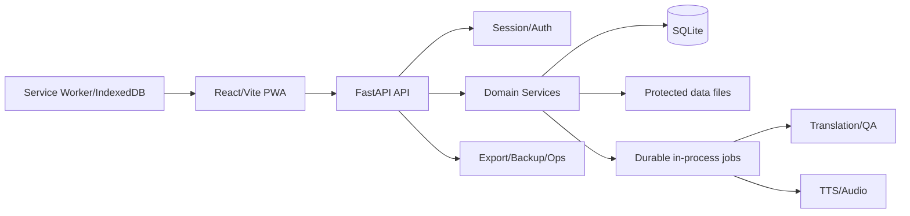

# Full Project Audit Implementation Note

## Repository Baseline

- Audit date: `2026-07-11`
- Repository: `/mnt/c/Users/thenam/Documents/Novel-TNN`
- Branch: `master`
- Baseline commit: `8f82e4c1f07ded2b7d28988151d7894ff785e9a3`
- Baseline subject: `Optimize multi-chapter import transactions`
- Source tree was clean at audit start.
- The repository is on Windows DrvFS (`/mnt/c`). Prior controlled measurements show this is materially slower than a WSL Linux filesystem; I/O-heavy results are labeled accordingly.

## Runtime Environment

- Project Python: `3.11.15` from `.venv/bin/python`
- Node: `22.23.0`
- npm: `10.9.8`
- SQLite: `3.50.4` through the project Python runtime
- ffmpeg/ffprobe: installed and exercised by existing fixture tests
- Free space at audit start: approximately `373 GB`; mounted filesystem reported `80%` used
- Production frontend: Vite-built static application
- Backend: FastAPI/Starlette application with SQLite and filesystem artifacts

No environment values, passwords, provider keys, cookies, or tokens are recorded here.

## Audit Isolation

- The active operator database was inspected read-only.
- Operator DB baseline SHA-256: `fc9bdefd43b501ebd5e590fdd22aa4de9aba56c137263d2f61fff32d95f88606`.
- Runtime browser checks used a synthetic database and data directory under the WSL Linux filesystem.
- Browser fixture: 3 synthetic books and 4 synthetic chapters, including raw-only, translated, QA-warning, and 400-paragraph long content.
- Paid translation and TTS providers were excluded.
- No live restore, destructive cleanup, database reset, or operator-content rewrite was performed.

## Architecture Summary

## Entry Points And Commands

- CLI: `python -m app.main`
- API: `python -m app.mobile_api`
- Local workflow: `scripts/start-local.sh`
- Cloudflare workflow: `scripts/start-cloudflare.sh`
- Verification: `scripts/verify.sh`
- Frontend development: `npm --prefix web run dev`
- Frontend build: `npm --prefix web run build`
- Frontend tests: `npm --prefix web test`
- Browser E2E: `npm --prefix web run test:e2e`

## Route And Module Map

- 126 HTTP route declarations were counted across feature routers.
- API registration is centralized in `app/mobile_api/main.py`.
- Backend domains: auth, health/status, books/chapters/reader, import, jobs, glossary, QA, providers, sources/catalog, TTS/audio, export, and backup.
- Frontend major routes are lazy-loaded from `web/src/App.tsx`.
- Browser persistence is handled by service-worker and reader-cache modules under `web/src/state`.

## Storage Summary

- Active DB: `data/pipeline.db`, approximately 47 MB.
- Data tree: approximately 5.9 GB in the last measured inventory.
- Main stores: `raw`, `cleaned`, `translated`, `book_assets`, `covers`, `audio`, `exports`, `glossary`, `logs`, dictionaries, import uploads, and model/TTS files.
- Root backup directory contains two archives, approximately 9.2 MB and 188.7 MB, with no manifest sidecars.
- Old TTS staging directories and smoke export directories remain under operator data. They were inventoried but not deleted.

## Operator Database Read-Only Snapshot

- Books: 15
- Chapters: 4,175
- Mobile jobs: 325
- Job logs: 59
- Glossary terms: 3,111
- QA reports: 695
- TTS jobs: 8
- Operational events: 16,396
- Ebook import runs: 12
- Managed sources: 0
- Reader progress/annotation records: 3
- Integrity check: `ok`
- Foreign-key violations: 0
- Duplicate active chapter keys: 0
- Duplicate book keys: 0
- Exact duplicate normalized glossary source terms: 72 groups/rows requiring operator-safe review

## Audit Methodology

1. Inspect repository and runtime baseline without mutation.
2. Map API routes, frontend routes, services, storage, and import graph.
3. Run dependency checks, static checks, full test/build verification, and targeted security inspection.
4. Inspect the operator DB read-only, including integrity, foreign keys, record counts, duplicate keys, job states, and stored artifact paths.
5. Start an isolated API and production frontend with synthetic data.
6. Exercise desktop `1440x1000`, mobile `390x844`, and small mobile `360x740` workflows.
7. Compare current observations with reproducible P1, P2A, and P2B measurements.
8. Record recommendations without applying architectural or data migrations.

## Important Limitations

- Browser timings from this audit are navigation probes, not official Core Web Vitals.
- Current canonical verification runs on `/mnt/c`; test/build duration is not representative of native Linux storage.
- Real-provider translation/TTS throughput and cost were not tested.
- No production restore was executed.
- Existing private chapters were not opened in reports or copied into fixtures.
- Current backup-list degradation is dataset-dependent: old archives lack sidecar manifests, causing archive reads.

## Excluded Destructive Systems

- Live database migration or path rewrite
- User data cleanup
- Production restore
- Paid provider jobs
- Full live-provider audiobook generation
- Source automation against unapproved remote sites
- Broad refactoring or schema redesign

## Evidence Outputs

Non-sensitive screenshots and browser measurements are under ignored directory `output/deep-audit-2026-07-11/`. Historical reproducible measurements remain under `output/live-audit-2026-07-10/` and the P2A/P2B documentation.
