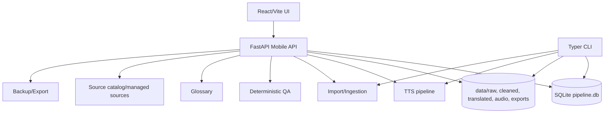

# Full Project Audit Report

## Executive Summary

### Overall Health Score
- `6.5 / 10` for private single-operator use

### Production Suitability
- Suitable in concept and architecture for a single operator
- Not fully production-ready in the current audit environment because local validation is blocked by dependency drift and one key frontend integration regression is failing

### Top Five Strengths
1. Domain coverage is broad and coherent: import, translation, QA, glossary, reader, TTS, export, backup, and source catalog are all represented
2. The backend is already split into feature routers and services instead of one giant application file
3. Security posture is intentionally conservative: auth guard, protected assets, public-deploy safety checks, and sensitive-path handling are present
4. The reader has rich operator features rather than a generic ebook viewer
5. The codebase already has a strong automated test culture, even though the current runtime environment prevents all of those tests from passing locally

### Top Ten Issues
1. Local environment drift blocks reliable startup and verification
2. Backend pytest under the available system Python misses required packages such as `jose` and `pyperclip`
3. The project venv itself fails to import FastAPI cleanly because `starlette` resolution is broken in the current environment
4. `scripts/verify.sh` fails early because `pyflakes` is not runnable as a module in this environment
5. `web/src/App.integration.test.tsx` has one failing translated-library-to-reader navigation test
6. `web/src/components/ReaderView.tsx` is very large and expensive to reason about
7. `web/src/components/ImportPanel.tsx` is also large and mixes many import flows
8. `web/src/styles.css` is oversized and centralizes too much presentation logic
9. `app/database/db.py` is a very large mixed-responsibility module
10. `app/mobile_api/services/pipeline_service.py` is similarly large and hard to maintain

### Most Urgent Action
- Repair the exact local Python environment so the API boots and the intended test suite can run under the same interpreter stack used by the repo

### Major Refactor Justified?
- Yes, but only in targeted slices
- The evidence supports incremental modularization, not a rewrite

## Audit Environment
- Root: `/mnt/c/Users/thenam/Documents/Novel-TNN`
- Branch: `master`
- Commit: none yet
- Python: host `3.12.3`, venv `3.11.15`
- Node: `22.23.0`
- npm: `10.9.8`
- ffmpeg/ffprobe: installed
- Disk free: 388G on `C:`
- Active DB: `data/pipeline.db`
- DB size: about 47 MB
- Important counts: 15 books, 4175 chapters, 3111 glossary terms, 4159 translated chapters, 8 audio files

## Repository and Architecture Overview

### Backend
- CLI entrypoint: `app/main.py`
- Mobile API entrypoint: `app/mobile_api/main.py`
- Health/readiness/version/status: `app/mobile_api/routers/health.py`
- Auth/session: `app/mobile_api/routers/auth.py`, `app/mobile_api/security.py`, `app/mobile_api/session_auth.py`
- Books/readers/annotations/dictionaries: `app/mobile_api/routers/books.py`
- Import workflows: `app/mobile_api/routers/import_routes.py`
- Jobs orchestration: `app/mobile_api/routers/jobs.py`, `app/mobile_api/services/job_service.py`
- QA: `app/mobile_api/routers/qa.py`, `app/mobile_api/services/qa_service.py`
- Glossary: `app/mobile_api/routers/glossary.py`, `app/mobile_api/services/glossary_service.py`
- Sources/source catalog: `app/mobile_api/routers/sources.py`, `app/mobile_api/routers/source_catalog.py`, `app/mobile_api/routers/source_adapter_candidates.py`
- TTS/audio: `app/mobile_api/routers/tts.py`, `app/mobile_api/routers/audio.py`, `app/services/tts/*`
- Export/backup: `app/mobile_api/routers/exports.py`, `app/mobile_api/routers/backups.py`, `app/mobile_api/services/export_service.py`, `app/mobile_api/services/backup_service.py`
- Database layer: `app/database/db.py`, `app/database/schema.py`
- Translation pipeline: `app/translation/*`
- Ingestion pipeline: `app/ingestion/*`

### Frontend
- Entry point: `web/src/main.tsx`
- App shell and routing: `web/src/App.tsx`, `web/src/components/AppShell.tsx`, `web/src/components/WorkflowShell.tsx`
- Library: `web/src/components/LibraryBooksView.tsx`
- Reader: `web/src/components/ReaderView.tsx` and `web/src/components/reader/*`
- Import: `web/src/components/ImportPanel.tsx`
- Jobs: `web/src/components/JobsView.tsx`
- Sources: `web/src/components/SourcesView.tsx`
- Glossary/QA: `web/src/components/GlossaryStyleView.tsx`, `web/src/components/GlossaryTmPanel.tsx`, `web/src/components/AssistPanel.tsx`
- Providers/settings: `web/src/components/ProvidersView.tsx`, `web/src/components/StatusSettingsView.tsx`
- Export/backup: `web/src/components/ExportView.tsx`
- PWA/offline: `web/src/components/PwaInstallPrompt.tsx`, `web/src/components/PwaNetworkStatus.tsx`, `web/src/state/serviceWorker.ts`
- API/state layer: `web/src/api/client.ts`, `web/src/state/*`
- Styling: `web/src/styles.css`

### Storage and Operations
- Primary SQLite DB: `data/pipeline.db`
- Raw/cleaned/translated content: `data/raw`, `data/cleaned`, `data/translated`
- Audio artifacts: `data/audio`
- Exports: `data/exports`
- Glossary data: `data/glossary`
- Runtime logs: `data/logs`
- Source data/inbox: `data/inbox`
- Caches: reader offline/cache state in browser storage and local cache files

### Architecture Diagram

## Verification Baseline

### Passed
- `git diff --check`
- `npm --prefix web run typecheck`
- `npm --prefix web run build`

### Failed or Blocked
- `scripts/verify.sh` fails early because `python -m pyflakes` cannot run in the current environment
- `pytest` under the available system interpreter reports many missing modules and a startup import problem
- `npm --prefix web test` fails on at least one integration case in `web/src/App.integration.test.tsx`
- Local API bootstrap via `scripts/start-local.sh` currently fails in the venv with a `fastapi/starlette` import error

### Backend Test Result Snapshot
- `pytest -q -s tests/test_mobile_api_security.py tests/test_ops_scripts.py tests/test_config_settings.py`
- Result: 21 failed, 26 passed
- Primary failure class: environment/dependency drift
- Secondary failure class: one configuration-dependent import failure

### Frontend Integration Result Snapshot
- `npx vitest --run src/App.integration.test.tsx`
- Result: 1 failed, 19 passed
- Failing test: translated-library navigation expects a reader heading `Đọc truyện`

## Feature Status Matrix

| Feature | Status | Evidence | Priority | Recommended Action |
|---|---|---|---|---|
| Login | NOT_TESTED | Backend auth tests blocked by missing `jose` in current interpreter | P0 | Repair environment and rerun auth tests |
| Logout | NOT_TESTED | Same as above | P0 | Same |
| Session expiry | NOT_TESTED | Same as above | P0 | Same |
| Logout-all | NOT_TESTED | Same as above | P0 | Same |
| Dashboard | PARTIALLY_WORKING | UI and router exist; runtime bootstrap blocked | P1 | Verify once API boots |
| Readiness/status | WORKING_WITH_LIMITATIONS | Health router and system status code exist; live run blocked | P1 | Validate live after env repair |
| Providers and models | PARTIALLY_WORKING | API/client and tests exist; not live-validated | P1 | Run backend tests with correct deps |
| Source catalog | PARTIALLY_WORKING | Dedicated routers and UI tab exist | P1 | Add live smoke and pagination check |
| Managed-source review | PARTIALLY_WORKING | Dedicated models/routers/UI exist | P1 | Live verify and document acceptance criteria |
| Source testing | PARTIALLY_WORKING | Code exists in source health/candidate flows | P1 | Run live source test with safe fixture |
| URL import | NOT_TESTED | Import URL tests import failure because backend deps missing | P0 | Fix env, rerun import URL tests |
| Paste import | PARTIALLY_WORKING | Import panel and router exist; UI tests present | P1 | Re-run integration after env repair |
| TXT import | PARTIALLY_WORKING | Client-side size checks and wizard flow exist | P1 | Verify on live fixture |
| EPUB/ebook import | NOT_TESTED | Ebook import tests blocked by missing backend deps | P1 | Fix env and rerun ebook tests |
| Duplicate detection | PARTIALLY_WORKING | Wizard/import metadata code paths exist | P1 | Validate with duplicate fixture |
| Create book | PARTIALLY_WORKING | API and UI exist | P1 | Live verify |
| Update book | PARTIALLY_WORKING | API and UI exist | P1 | Live verify |
| Chapter management | PARTIALLY_WORKING | Backend/reader code present | P1 | Validate chapter CRUD |
| Translation job creation | PARTIALLY_WORKING | Job router and service exist | P1 | Live verify with safe mock |
| Translation progress | PARTIALLY_WORKING | Job state hooks and SSE exist | P1 | Verify polling behavior |
| Retry | PARTIALLY_WORKING | Job retry code and UI exist | P1 | Live verify |
| Cancel | PARTIALLY_WORKING | Job cancel code and UI exist | P1 | Live verify |
| Stale recovery | PARTIALLY_WORKING | Job tracker has stale interruption logic | P1 | Validate with controlled stale job |
| Glossary extraction | PARTIALLY_WORKING | Glossary service and UI exist | P1 | Live verify |
| Glossary review | PARTIALLY_WORKING | Review UI and DB fields exist | P1 | Live verify |
| Glossary conflict detection | PARTIALLY_WORKING | Conflict logic exists in DB/service layer | P1 | Add fixture test if missing |
| Deterministic QA | PARTIALLY_WORKING | QA service and router exist | P1 | Live verify |
| QA display | PARTIALLY_WORKING | Assist and reader QA panels exist | P1 | Validate in browser |
| Library | PARTIALLY_WORKING | `LibraryBooksView` and tests exist | P1 | Re-run integration smoke |
| Reader | PARTIALLY_WORKING | Large reader surface and tests exist | P1 | Validate with live browser |
| Reader modes | WORKING_WITH_LIMITATIONS | Code for translation/raw/split/collapsed/QA overlay exists and is tested, but not live-validated | P1 | Keep, but reduce complexity |
| Progress tracking | PARTIALLY_WORKING | Reader progress hooks and DB schema exist | P1 | Live verify |
| Bookmarks | PARTIALLY_WORKING | Reader annotations exist | P1 | Live verify |
| Highlights | PARTIALLY_WORKING | Reader annotations exist | P1 | Live verify |
| Notes | PARTIALLY_WORKING | Reader annotations exist | P1 | Live verify |
| Offline cache | PARTIALLY_WORKING | Reader offline cache modules and service worker exist | P1 | Validate on mobile/browser |
| PWA install | PARTIALLY_WORKING | Prompt exists | P2 | Validate in browser |
| TTS chapter generation | PARTIALLY_WORKING | TTS routers/services exist; no live synthesis run | P1 | Dry-run with fixture only |
| TTS bulk generation | PARTIALLY_WORKING | Job runner supports batch jobs | P1 | Safe fixture run |
| Chunk retry | PARTIALLY_WORKING | Retry path exists | P1 | Validate with fixture |
| MP3 playback | PARTIALLY_WORKING | Audio route exists | P1 | Browser validate |
| MP3 download | PARTIALLY_WORKING | Download route exists | P1 | Browser validate |
| M4B generation | PARTIALLY_WORKING | Export service and job code exist | P1 | Fixture-only verify |
| Export | PARTIALLY_WORKING | TXT/DOCX/EPUB export exists | P1 | Live verify |
| Backup | PARTIALLY_WORKING | Backup service and router exist | P1 | Live verify |
| Restore drill | NOT_TESTED | Deliberately excluded from destructive testing | P0 | Document and test on non-production copy only |
| Protected file access | WORKING_WITH_LIMITATIONS | Private asset path guards and auth middleware exist; live smoke blocked | P0 | Recheck in a healthy local environment |

## Working Well
- Domain coverage is strong
- The app already has explicit operator workflows instead of hiding everything behind a generic dashboard
- Security checks around public deploy and protected assets are clearly intentional
- The frontend component tree has tests in the right places
- Many caches and state concerns are already separated under `web/src/state`

## Broken Or Incorrect
- Local API startup in the current environment
- Backend test environment for the current shell
- One translated-library reader integration case
- `scripts/verify.sh` under current env

## Working With Limitations
- Most core backend and frontend features appear implemented, but live validation is blocked by environment and one UI regression
- Reader and import surfaces are functional but too large to be comfortable long-term

## Missing Functions
- No explicit evidence of a safe restore drill workflow being executed
- No live provider TTS dry-run in this audit
- No live page-load measurements because the local API did not start

## Security Regression Findings
- Private APIs still require auth by design
- Protected audio/export/backup routes are present
- Public-deploy safety checks exist
- Sensitive paths are intentionally blocked from public disclosure
- No raw secrets were exposed in this audit
- No regression was proven in the security model

## Backend Performance Findings
- The largest backend modules are `app/database/db.py`, `app/mobile_api/services/pipeline_service.py`, `app/mobile_api/services/job_service.py`, `app/mobile_api/routers/import_routes.py`, and `app/mobile_api/routers/books.py`
- The backend architecture is domain-separated but not yet fully modular
- No live route latency measurements were possible because the API bootstrap failed in the current environment
- The most likely hotspots are large query helpers, import preview/commit paths, and job status polling

## Frontend Performance Findings
- Build output is healthy but large
- The reader chunk is the biggest JS chunk
- `styles.css` is extremely large
- The frontend has many lazy-loaded route chunks, which is good, but the reader remains the heavy route

## Page-Load Findings
- Not live-measured due API bootstrap failure
- Expected first optimization targets:
  - login/dashboard boot path
  - library load
  - reader open
  - import wizard open

## Import Performance Findings
- 5 MB browser-side parsing is acceptable for this operator app, but it is the upper edge of comfortable browser processing
- Beyond that, UX will become progressively worse without server-side preview sessions or chunked uploads
- The browser-side validation is useful, but it still means the full payload is held in memory

## Reader Performance Findings
- Reader state is already decomposed into many hooks
- The remaining risk is the size and complexity of the rendering component, not an obvious lack of hooks
- Virtualization is not yet proven necessary from the evidence collected

## TTS Performance Findings
- Non-provider TTS code is already separated into chunking, merging, normalization, and QA modules
- No live provider synthesis was run
- TTS overhead should be audited only with safe fixture data or approved dry-run scopes

## Desktop UI/UX Findings
- The app is operator-first and information-dense
- That is appropriate for the product
- The main desktop UX issue is the density of the reader and import surfaces
- No broad visual redesign is justified yet

## Mobile UI/UX Findings
- Mobile support exists and is intentional
- The mobile panel system and PWA affordances are good signs
- The reader and import screens are the main mobile risk areas
- The app likely needs tightening, not a new mobile design language

## Accessibility Findings
- Many aria labels and roles are present
- The app is likely more accessible than a typical bespoke console
- A focused keyboard/focus audit is still needed, especially for dialogs and drawers

## Data Integrity Findings
- DB schema and migration helpers are present
- Counts and foreign-key-sensitive structures look coherent at a glance
- No destructive cleanup was run
- No orphan cleanup or restore drill was executed

## Observability and Operations Findings
- Readiness and system status endpoints exist
- The system emits job and operational events
- The operator can see a lot, but the current environment prevented a full live “why did it fail?” test
- Storage growth, backup failures, and missing artifacts should remain easy to detect if runtime logs stay healthy

## Code Quality Findings
- The code is not chaotic
- The main code smell is concentration of responsibility in a few large modules
- The test suite is broad and valuable, but current dependency drift prevents it from doing its job locally

## Modularity Assessment
- Yes, further splitting is justified
- Highest priority split candidates:
  - `app/database/db.py`
  - `app/mobile_api/services/pipeline_service.py`
  - `web/src/components/ReaderView.tsx`
  - `web/src/components/ImportPanel.tsx`
  - `web/src/styles.css`
- Files that should remain unchanged for now:
  - `app/mobile_api/config.py`
  - `app/mobile_api/security.py`
  - the already-focused state hooks under `web/src/state`

## Dependency and Deprecation Findings
- Current env drift is more urgent than deprecation cleanup
- Previously noted deprecation warnings:
  - `vinorm`
  - `passlib/bcrypt`
  - `jieba/pkg_resources`
- These should be handled in a later upgrade pass, not during the audit

## AUDIT_FIX_APPLIED
- None

## RECOMMENDATION_ONLY

### P0
- Repair the Python environment and dependency install so the mobile API starts and pytest runs under the intended interpreter
- Re-run the full verify script once the environment is fixed

### P1
- Fix the translated-library-to-reader integration regression or update the expectation if the copy changed intentionally
- Split the reader component and global stylesheet
- Split the database and pipeline service modules by domain

### P2
- Consider server-side import preview sessions for large text payloads
- Add live timing instrumentation for the highest-value routes
- Split import and job routers after the service layer is better separated

### P3
- Plan dependency migration work for deprecated packages
- Separate feature CSS into smaller files

## Prioritized Roadmap

### P0
- Repair runtime dependencies and bootstrap
- Fix the failing reader/library integration
- Re-run backend and frontend verification from a healthy environment

### P1
- Reduce reader bundle size
- Reduce CSS size
- Split large backend service/router modules

### P2
- Improve import architecture for large payloads
- Improve route timing observability
- Normalize feature ownership in smaller modules

### P3
- Dependency cleanup
- Additional visual polish

## Proposed Follow-Up Phases

### Phase 1
- Goal: restore trustworthy local verification
- Scope: fix Python env, runner scripts, backend imports, and test entrypoints
- Excluded work: feature rewrites
- Likely modules: environment, `scripts/*`, dependency install metadata
- Tests required: verify script, backend pytest, frontend typecheck/build
- Acceptance criteria: API starts and current tests run consistently

### Phase 2
- Goal: reduce the highest-complexity frontend surfaces
- Scope: split reader and import components
- Excluded work: visual redesign
- Likely modules: `ReaderView.tsx`, `ImportPanel.tsx`, reader subcomponents
- Tests required: integration tests and targeted component tests
- Acceptance criteria: behavior preserved, modules smaller, no new regressions

### Phase 3
- Goal: improve backend maintainability
- Scope: split `db.py`, `pipeline_service.py`, and large routers
- Excluded work: schema redesign
- Likely modules: database, services, routers
- Tests required: backend unit and integration tests
- Acceptance criteria: smaller domain-oriented modules, same API surface

## Test and Measurement Results
- `npm --prefix web run build`: 23.52s
- `npm --prefix web run typecheck`: passed
- `git diff --check`: passed
- `pytest` backend sample: 21 failed, 26 passed
- `npx vitest --run src/App.integration.test.tsx`: 1 failed, 19 passed

## Remaining Unknowns
- Exact live API latency numbers
- Exact page-load timing numbers
- Live provider TTS behavior
- Live restore drill behavior
- Live browser/mobile performance in a healthy runtime

## Final Recommendation
- Do not refactor broadly yet
- First repair the runtime environment and verify the current app under the intended interpreter stack
- Then split the largest reader/import/database modules incrementally
- Treat the current codebase as maintainable but overdue for targeted modularization, not as a rewrite candidate

## Scoring

| Category | Score | Basis |
|---|---:|---|
| Functionality | 7 | Broad feature coverage, but live validation is blocked |
| Workflow clarity | 7 | Domain workflow structure is clear |
| Backend architecture | 6 | Good separation, but some very large modules |
| Frontend architecture | 6 | Strong state split, but giant reader/import surfaces |
| Code maintainability | 5 | Big concentrated modules reduce change safety |
| Test quality | 7 | Many tests exist, but current env drift blocks them |
| Security | 7 | Strong private-by-default posture |
| Performance | 6 | Build is healthy; bundle sizes and giant modules are the risk |
| Desktop UI/UX | 7 | Functional and operator-oriented |
| Mobile UI/UX | 6 | Intentional support, but needs more validation |
| Import experience | 6 | Good flows, but 5 MB browser ceiling is tight |
| Reader experience | 7 | Feature-rich and strong, but heavy |
| TTS/audio reliability | 6 | Pipeline is mature, live validation still missing |
| Backup/operations | 7 | Good safeguards and dedicated surfaces |
| PWA/offline behavior | 6 | Exists, but not live-validated here |
| Private production readiness | 6 | Conceptually yes, practically blocked by env drift |
| SaaS readiness | 2 | Not a target and would need a different architecture |
