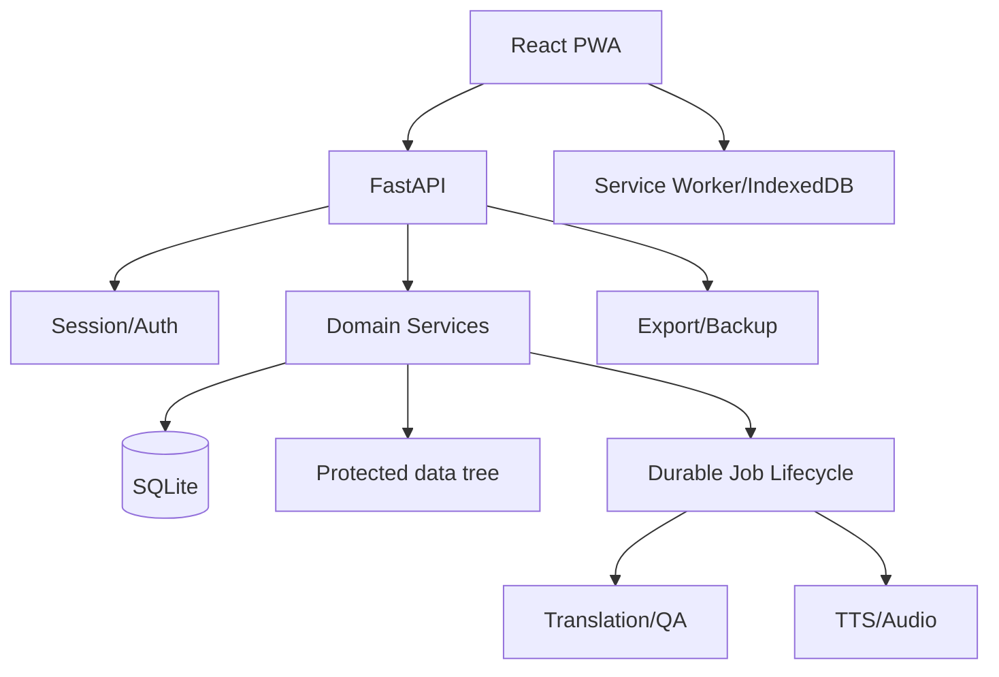

# Full Project Audit Report

## Executive Summary

### Overall Health

- Overall health: **7.2/10**.
- Private single-operator production suitability: **conditional**. The application, automated verification, auth model, import pipeline, and job lifecycle are strong, but stored artifact paths must be migrated before the current operator library can be trusted end to end.
- Major refactoring is **not** the urgent action. Correctness and backup operability come first; modularization should then proceed incrementally.

### Top Five Strengths

1. Verification is broad and currently green: 656 backend tests, 605 frontend tests, 5 Playwright E2E tests, production build, lint/static checks, and dependency integrity.
2. Security is intentionally conservative: authenticated private APIs, protected artifacts, SSRF/path guards, public-deploy sanitization, masked providers, and EPUB sanitization.
3. P2A and P2B delivered measured performance gains without schema or architecture rewrites.
4. Domain workflow coverage is unusually complete for a private app: import, translation, QA/glossary, Reader, TTS/audio, sources, export, backup, PWA, and operations.
5. SQLite itself is healthy: integrity check passes, no foreign-key violations, no duplicate active chapter keys, and no duplicate book keys.

### Top Ten Issues

1. **P0:** DB artifact metadata still points to the deleted old project root; current files exist but Reader/audio/cover access can fail.
2. **P1:** backup listing scans compressed archives when sidecars are absent; current list request exceeded 20 seconds.
3. **P1:** backup creation remains synchronous and measured 11.4-17.5 seconds on small fixtures.
4. **P1:** authenticated status API/UI exposes absolute database and data-directory paths.
5. **P1:** active operational docs contain stale old-root commands.
6. **P1:** Reader QA reached 599 ms and about 5,182 DOM nodes; duplicate request ownership remains.
7. **P1/P2:** operational events have grown to 16,396 rows without a demonstrated retention ceiling.
8. **P2:** 72 exact normalized glossary duplicates require operator review.
9. **P2:** large modules and a PipelineService/QA circular import increase regression risk.
10. **P2:** mobile library density, import instruction layout, touch targets, and PWA prompt behavior need targeted improvement.

### Most Urgent Action

Perform a controlled artifact-path migration: fresh backup, copied-DB rehearsal, prefix/containment validation, integrity/hash checks, then operator-approved migration with rollback. Do not delete or regenerate content.

## Audit Environment

- Date: `2026-07-11`
- Root: `/mnt/c/Users/thenam/Documents/Novel-TNN`
- Branch/commit: `master` at `8f82e4c1f07ded2b7d28988151d7894ff785e9a3`
- Python: `3.11.15` project venv
- Node/npm: `22.23.0` / `10.9.8`
- Filesystem: WSL-mounted Windows filesystem; canonical performance evidence uses prior isolated Linux-filesystem runs
- Operator DB: inspected read-only; isolated synthetic DB used for runtime/browser writes
- ffmpeg/ffprobe: available; fixture media validation exists
- Paid providers and live restore: excluded

See `docs/full-project-audit-implementation-note.md` for methodology and isolation.

## Repository And Architecture Overview

- 126 API route declarations across auth, health/status, books/Reader, import, jobs, QA/glossary, providers, sources, TTS/audio, export, and backup.
- FastAPI app/router registration: `app/mobile_api/main.py`.
- SQLite lifecycle/schema: `app/database/db.py`, `app/database/schema.py`.
- React/Vite entry: `web/src/main.tsx`; orchestration: `web/src/App.tsx`.
- Major routes lazy-load; Reader remains the largest route chunk.
- Durable in-process jobs support persisted state, logs, retry, cancel, and stale recovery.
- Filesystem content and artifacts are served through authenticated protected routes.

## Verification Baseline

| Command/check | Result | Notes |
|---|---|---|
| `scripts/verify.sh` | PASS | Reached final production build; exit pipeline completed |
| Backend pytest | 656 passed | 2 known deprecation warnings; approximately 880.58 s on `/mnt/c` |
| Frontend Vitest | 605 passed in 70 files | 566.06 s on `/mnt/c` |
| Production build | PASS | 1,841 modules; 12.45 s |
| Playwright E2E | 5 passed | 21.8 s; auth, import, Reader/workbench, translation-job mock, TXT export |
| `pip check` | PASS | No broken Python dependency graph |
| `npm audit --omit=dev` | PASS | 0 reported vulnerabilities |
| `npm ls` | PASS | No invalid/duplicate-tree error |
| `git diff --check` | PASS | Documentation changes clean |

Warnings: `passlib` uses deprecated `crypt`; `jieba` uses deprecated `pkg_resources`; Playwright reports `NO_COLOR` ignored when `FORCE_COLOR` is set; Vite reports asset/resolve/CSS plugin timing concentration.

## Feature Status Matrix

`WORKING` means automated or live fixture evidence exists. Provider-dependent and destructive operations are not promoted to `WORKING` without direct evidence.

| Feature | Status | Evidence / impact | Priority / action |
|---|---|---|---|
| Login / invalid login | WORKING | Live synthetic login and E2E auth pass | Keep |
| Logout / logout-all | WORKING | Backend/frontend auth tests pass | Keep |
| Session restore/expiry/refresh | WORKING | Auth/session suites pass | Keep |
| Unauthorized routes | WORKING | E2E and security tests return denial | Keep |
| Health/readiness | WORKING | Isolated `/api/health` and `/api/ready` HTTP 200 | Keep |
| Dashboard/status | WORKING_WITH_LIMITATIONS | Live view renders; backup list can block and paths are exposed | P1 fix response contract/list |
| Providers/models | WORKING | View/API tests pass; key masking verified | Keep |
| Source catalog | WORKING | Router/UI/test coverage; live synthetic view renders | Keep |
| Managed-source review | WORKING_WITH_LIMITATIONS | Code/tests pass; operator DB currently has zero managed sources | Validate with approved source fixture |
| Source testing | WORKING_WITH_LIMITATIONS | Safe test paths exist; no broad live remote exercise | Keep guarded |
| URL import | WORKING | SSRF and import tests pass with safe fixtures | Keep |
| Paste/TXT import | WORKING | UI/E2E/transaction suites pass | Keep |
| EPUB/ebook import | WORKING | Sanitization and import suites pass | Keep |
| Duplicate detection | WORKING | P2B bounded query and stale revalidation tested | Keep |
| Create/update book | WORKING | API/frontend tests pass | Keep |
| Chapter management | WORKING_WITH_LIMITATIONS | CRUD tests pass; operator artifact paths are stale | P0 migrate paths |
| Translation job creation | WORKING_WITH_LIMITATIONS | Mock/E2E job creation passes; paid provider excluded | Provider smoke only with approval |
| Translation progress | WORKING | Durable status/log tests pass | Keep |
| Retry/cancel/stale recovery | WORKING | Job lifecycle tests pass | Keep |
| Glossary extraction/review | WORKING_WITH_LIMITATIONS | Tests pass; 72 duplicate normalized terms | P2 review duplicates |
| Glossary conflict detection | WORKING | Deterministic conflict tests exist | Keep |
| Deterministic QA / display | WORKING_WITH_LIMITATIONS | QA tests and UI pass; long QA rendering is expensive | P1 progressive render |
| Library | WORKING | Live view/E2E; P2A route 5.188 ms at 59 books | Keep |
| Reader / modes | WORKING_WITH_LIMITATIONS | E2E and fixture view pass; current operator paths can fail; QA cost | P0 path migration, P1 request ownership |
| Progress/bookmarks/highlights/notes | WORKING | Reader state/annotation tests pass | Keep |
| Offline cache | WORKING_WITH_LIMITATIONS | Cache/service-worker tests pass; full offline eviction not tested | Device audit later |
| PWA install | WORKING_WITH_LIMITATIONS | Prompt renders; mobile prompt is intrusive | P2 dismissal/backoff |
| TTS chapter/bulk/chunk retry | WORKING_WITH_LIMITATIONS | Fixture tests pass; real provider speed not tested | Keep provider bounded |
| MP3 playback/download | WORKING_WITH_LIMITATIONS | Protected route/artifact tests pass; operator paths stale | P0 path migration |
| M4B generation | WORKING_WITH_LIMITATIONS | Valid fixture artifact; no chapter markers | Decide marker contract |
| TXT/DOCX/EPUB/glossary export | WORKING | Fixture exports and E2E TXT pass | Keep |
| Backup list | BROKEN | Current request exceeded 20 s due missing sidecars | P1 metadata-only list |
| Backup creation | WORKING_WITH_LIMITATIONS | Correct output/security; synchronous 11.4-17.5 s | P1 job-backed backup |
| Encrypted secret backup | WORKING_WITH_LIMITATIONS | Rules/tests pass; live passphrase operation excluded | Preserve no-persistence rule |
| Restore drill | NOT_TESTED | Deliberately excluded from active data | Isolated drill before release |
| Protected file access | WORKING | Auth/traversal tests pass | Keep |
| Deployment/public mode | WORKING_WITH_LIMITATIONS | Sanitization/docs/tests pass; active docs contain stale root | P1 update runbooks |

## Working Well

- Environment recovery is complete and deterministic.
- P2A connection/library optimization and P2B transaction import are correct and materially faster.
- Auth, protected routes, provider masking, SSRF validation, traversal blocking, and service-worker private-route denylist remain effective.
- Import sanitization treats hostile HTML/EPUB content as inert/filtered content.
- Production route lazy loading works; normal local useful state meets the directional 2-second target.
- Tests isolate data and cover major operator workflows.

## Broken Or Incorrect

### Stored Artifact Paths

- Stored absolute paths reference deleted `/home/thenam176/novel_pipeline`.
- Files exist under current `data/` after deterministic prefix remapping.
- Representative PipelineService source retrieval returned no source content using the stored path.
- This affects raw, translated, HTML, audio, cover, and TTS artifact metadata.

### Backup List

- `GET /api/system/backups` exceeded 20 seconds.
- Missing sidecar manifests cause compressed archives to be opened during listing.
- A 188.7 MB archive makes the issue operator-visible now.

### Operational Documentation

- Active runbooks/deployment/backup docs retain old-root commands and should not be trusted verbatim.

## Working With Limitations

- Reader and audio functionality is correct on synthetic/current-path fixtures but not reliable for all current operator records until migration.
- Backup artifacts are protected and valid, but creation/listing execution is unsuitable for growing data.
- TTS logic is validated in fixture mode; real-provider throughput/cost remains unknown.
- PWA/offline behavior is tested structurally and in local Chromium, not under mobile storage eviction or long offline periods.
- Mobile interface is usable but dense.

## Missing Functions

- Job-backed system backup is not implemented.
- No automatic safe migration exists for project-root relocation.
- No documented/enforced operational-event retention policy.
- M4B chapter markers are absent if they are considered part of audiobook requirements.
- No formal WCAG or low-end Android performance certification.
- SaaS/multi-user capabilities are intentionally absent and should remain absent.

## Security Regression Findings

- No unauthenticated private API, artifact, export, or backup bypass was reproduced.
- Provider secrets remain masked; no secrets were printed or added to reports.
- Service worker denies private API/audio/export/backup/data paths.
- EPUB rich HTML is allowed only after server-side sanitizer filtering; scripts, iframe/object, `javascript:`, data URLs, and external tracking assets are rejected by code/tests.
- **Regression:** authenticated system status returns absolute `data_dir` and `database_path`, and the UI renders both. This is lower severity than a public leak but violates the established no-internal-path contract.
- DrvFS permissions are broad by Windows filesystem semantics; this is an environment deployment concern, not a proven remote application vulnerability.

## Backend Performance Findings

- DB setup and library N+1 are resolved: 0.035 ms connection and 5.188 ms 59-book route median on Linux fixtures.
- Multi-chapter commit is resolved: 144.083 ms 120-chapter route median.
- Backup list and creation are the dominant current backend workflow bottlenecks.
- Operational-event and artifact-directory growth need bounded retention/cleanup policy.
- Existing indexes are effective; no speculative index is recommended.

## Frontend Performance Findings

- Main JS 341.96 KB raw/106.78 KB gzip.
- Reader 181.73 KB raw/49.54 KB gzip.
- Global CSS 188.78 KB raw/32.26 KB gzip.
- Import 49.70 KB raw/13.41 KB gzip.
- Route lazy loading is effective; Reader optional capabilities are the next evidence-backed lazy boundary.

## Page-Load Findings

- P1 login visible: 91-161 ms; authenticated shell: 830-844 ms.
- Cold major routes were usually under one second; warm routes generally 143-160 ms with settle allowance.
- Current synthetic browser pass had zero console errors and zero measured page overflow.
- Do not interpret these Playwright probes as Core Web Vitals.

## Import Performance Findings

- 5 MB client-side handling is acceptable at the current cap.
- P2B proves chapter count/transaction behavior, not payload bytes, caused the previous 5.62-second case.
- 120-chapter route median is now 144.083 ms with one bounded transaction/query path.
- Server preview sessions, Web Worker parsing, chunked upload, or a higher limit are not justified now.

## Reader Performance Findings

- Normal chapter open/switch meets the local target.
- Text does not wait on audio/dictionary state.
- Duplicate requests and QA expansion are current bottlenecks.
- Long QA reached 599 ms/5,182 DOM nodes.
- Progressive QA rendering should be tested before virtualization.

## TTS Performance Findings

- Fixture non-provider pipeline: 6.89-7.09 seconds for two MP3 chapters plus one M4B, 9/9 checks passing.
- Normalization/chunking are cheap; merge/ffmpeg startup scales with file count.
- Cache/retry logic is covered by tests.
- Real-provider speed is NOT_TESTED and must not be inferred from fixture timing.

## Desktop UI/UX Findings

- Strong hierarchy and domain navigation.
- Library and status surfaces are understandable and visually consistent.
- Backup blocking and path display are must-fix operational issues.
- Reader/import density should be reduced selectively, not through broad redesign.

## Mobile UI/UX Findings

- No measured horizontal overflow at 390x844 or 360x740.
- Bottom navigation keeps domains reachable.
- Two-column library, dense import steps, small controls, and intrusive PWA prompt reduce usability.
- Use one-column compact cards and durable install-prompt backoff.

## Accessibility Findings

- Measured routes had named buttons/inputs and status text beyond color.
- No formal contrast, keyboard-complete, reduced-motion, or screen-reader certification was completed.
- Touch targets and Reader nested control surfaces need dedicated follow-up.

## Data Integrity Findings

- `PRAGMA integrity_check`: `ok`.
- Foreign-key violations: 0.
- No duplicate active chapter keys or book keys.
- 72 exact normalized glossary duplicates require review, not automatic deletion.
- 310 jobs completed, 13 failed, and 2 interrupted; no nonterminal cancel requests were found.
- Stored paths are the critical integrity/availability issue even though content files remain present.

## Observability And Operations Findings

- Operator can inspect readiness, job state, logs, retries, stale jobs, QA, and recent operational events.
- Job logs are bounded in API behavior; operational-event storage retention is not proven bounded.
- Status exposes storage size but currently includes internal paths and can be delayed by backup listing.
- Old TTS staging and smoke export directories indicate cleanup/retention gaps.
- The operator cannot reliably distinguish “file missing” from “path moved” in Reader errors today.

## Code Quality Findings

- Domain routers/services exist and tests are substantial.
- Oversized modules concentrate change risk: CSS 12,244 lines, DB 6,225, PipelineService 5,700, ReaderView 5,251, App 2,026, ImportPanel 1,991.
- A direct `pipeline_service -> qa_service -> pipeline_service` import cycle should be broken before broader service extraction.
- Business orchestration remains in large route/service/UI files, but narrow P2A/P2B seams show an incremental path.

## Modularity Assessment

- Should the code be divided further? **Yes, incrementally.**
- First split: Reader data ownership/rendering/optional panels after correctness fixes.
- Second: break PipelineService/QA cycle and extract content/Reader services.
- Third: domain DB repositories behind a compatibility facade.
- Fourth: Import adapters/review components; its performance no longer requires urgent architecture change.
- Last: CSS feature files with screenshot regression coverage.
- Keep security/config/schema core, focused Reader state modules, TTS domain modules, and public route contracts unchanged for now.

See `docs/code-modularity-plan.md` for dependency direction and sequence.

## Dependency And Deprecation Findings

- `pip check`, `npm ls`, and npm production audit pass.
- FastAPI/Starlette/Pydantic runtime is currently compatible.
- `passlib/crypt` and `jieba/pkg_resources` warnings need planned migrations, not emergency upgrades.
- `bcrypt<4.1` is intentional for passlib compatibility; do not blindly upgrade.
- Python deployment reproducibility is weaker than npm's lockfile and should gain reviewed constraints/lock policy.

## AUDIT_FIX_APPLIED

None. This audit changed documentation only. It did not migrate data, refactor product modules, modify backup behavior, or alter provider execution.

## RECOMMENDATION_ONLY

### P0 Artifact Path Migration

- Evidence: thousands of stored old-root paths; all tested classes remap to existing current files.
- Impact: Reader/audio/cover availability and operator trust.
- Scope: small-medium controlled migration plus tests and rollback.
- Acceptance: no old-root paths, containment valid, integrity/hash checks pass, representative workflows work.

### P1 Backup Metadata And Job Workflow

- Evidence: list >20 s; create 11.4-17.5 s synchronous.
- Impact: settings blocking, timeout, no progress/cancel/retry.
- Scope: medium.
- Acceptance: metadata-only list under 250 ms; HTTP 202 durable job; staged protected artifact; passphrase never persisted.

### P1 Status Path Redaction

- Evidence: API/UI absolute paths.
- Impact: unnecessary internal topology disclosure.
- Scope: small.
- Acceptance: no absolute path in status response/UI; useful size/readiness retained.

### P1 Reader Request/QA Optimization

- Evidence: duplicate loads and 599 ms/5,182-node QA.
- Impact: slow interaction on long chapters.
- Scope: medium.
- Acceptance: one request owner and progressive long-QA rendering without normal-chapter regression.

### P2 Data Retention And Glossary Review

- Evidence: 16,396 events, old staging/export directories, 72 duplicate terms.
- Impact: silent growth and terminology inconsistency.
- Scope: medium with operator review.
- Acceptance: bounded policy, dry-run report, no automatic private-data deletion.

## Prioritized Roadmap

- **P0:** controlled artifact-path migration.
- **P1:** backup list sidecars and job-backed creation; status path redaction; active runbook path cleanup; Reader request/QA work.
- **P2:** retention tooling, glossary duplicate review, Reader/service/repository modularization, mobile library/import/accessibility fixes.
- **P3:** CSS split, M4B marker enhancement, dependency modernization, low-end Android/WAN/formal accessibility audits.

## Proposed Follow-Up Phases

### Phase 1: Path Migration

- Goal: restore operator content availability.
- Scope: copied-DB rehearsal, path resolver/migration, representative Reader/audio/cover checks.
- Excluded: content regeneration/deletion.
- Tests: migration idempotency, containment, rollback, DB hash/integrity, E2E Reader.

### Phase 2: Backup Operability

- Goal: metadata-only list and durable job-backed backup.
- Scope: sidecars, staging/publication, progress/cancel/retry/stale cleanup.
- Excluded: restore UI or restore-format redesign.
- Tests: security, passphrase lifecycle, artifact compatibility, cancellation, list latency.

### Phase 3: Reader Correctness And Rendering

- Goal: one data owner and bounded long-QA rendering.
- Scope: request consolidation, progressive QA, then pure rendering/optional panel extraction.
- Excluded: visual redesign and speculative virtualization.
- Tests: modes, annotations, audio, offline, long fixture, E2E.

### Phase 4: Domain Modularity

- Goal: reduce service/repository change risk.
- Scope: break QA cycle, compatibility-facade repository extraction, Import adapter extraction.
- Excluded: ORM/schema/public API redesign.
- Tests: full verification and query/performance contracts after each extraction.

## Test And Measurement Results

- Full backend: 656 passed, 2 warnings.
- Full frontend: 605 passed in 70 files.
- Playwright: 5 passed.
- Build: 1,841 modules, 12.45 seconds on `/mnt/c`.
- P2A: 0.035 ms DB connection; 5.188 ms 59-book library.
- P2B: 144.083 ms 120-chapter authenticated route.
- Current backup list: exceeded 20-second timeout with two legacy archives lacking sidecars.
- Operator DB integrity: ok, 0 FK violations.
- Browser: no console errors or horizontal overflow on measured routes/viewports.

## Scores

| Category | Score / 10 | Evidence summary |
|---|---:|---|
| Functionality | 8.0 | Broad green suites; current artifact paths reduce real-data availability |
| Workflow clarity | 7.5 | Strong domain navigation; backup/path failures are misleading |
| Backend architecture | 7.0 | Domain services/routers and durable jobs; large service/DB modules |
| Frontend architecture | 6.5 | Lazy routes and state modules; App/Reader/Import/CSS concentration |
| Code maintainability | 6.0 | Excellent tests offset large modules and circular import |
| Test quality | 9.0 | 1,261 unit/integration tests plus 5 E2E |
| Security | 7.5 | Strong auth/guards/sanitization; authenticated status path leak |
| Performance | 7.5 | P2A/P2B excellent; backup and long QA remain |
| Desktop UI/UX | 7.5 | Clear and stable, operationally dense |
| Mobile UI/UX | 6.0 | Reachable/no overflow; density/touch/prompt issues |
| Import experience | 8.5 | Unified, bounded, and now fast/transactional |
| Reader experience | 7.0 | Rich and fast normally; path/QA/request limitations |
| TTS/audio reliability | 7.5 | Strong fixture validation; real provider and current paths limited |
| Backup/operations | 5.0 | Correct security/format, but list/create request behavior is poor |
| PWA/offline behavior | 7.0 | Hardened cache/denylist; device eviction and prompt UX remain |
| Private production readiness | 6.5 | Conditional on path migration and backup fix |
| SaaS readiness | 2.0 | Intentionally private/single-operator; SaaS is not a target |

## Remaining Unknowns

- Real-provider translation and TTS speed, cost, throttling under actual credentials.
- Live production restore compatibility on a full-size copy.
- Low-end Android memory/battery and long-term offline cache eviction.
- Production WAN/Cloudflare latency and outage behavior.
- Full-size backup duration, cancellation latency, and encrypted retry because job-backed backup is absent.
- M4B chapter marker compatibility across target players.
- Formal WCAG contrast/screen-reader coverage.

## Final Recommendation

Keep the server-first, private single-operator architecture and current product scope. Do not start a broad refactor. First restore operator data-path correctness, then fix backup listing/creation and status path disclosure. After those are green, optimize Reader request/QA behavior and split Reader first, backend service/repository seams second, Import third, and CSS last.
